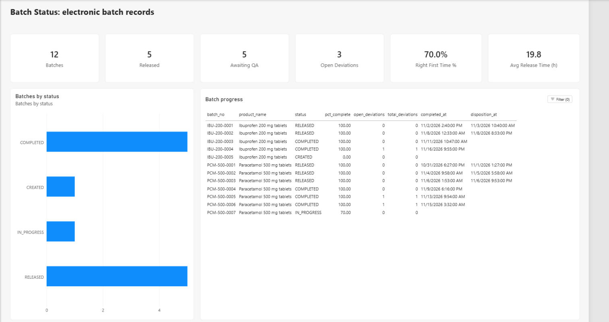

# Pharmaceutical MES Portfolio

Simulated pharmaceutical MES and electronic batch record system (Python, Streamlit, PostgreSQL) with audit trail, deviation handling and QA review. Learning project, not a validated GxP system.

> All products, lots, suppliers and people are fictional. Process signals come from a Python simulator, published over OPC UA by a local Python server, not from a real DCS.

## Highlights

**GMP rules live in the database.** PostgreSQL triggers enforce them, so they apply whichever front end writes the data, whether that is Streamlit, a script, a test or a future Tulip app.

| Area | Rule enforced by PostgreSQL |
|---|---|
| **Dispensing** | Lot must be RELEASED, unexpired, the right material and have enough stock. A second person must verify, and the verifier cannot be the dispenser. Dispensed quantities cannot be edited. |
| **Deviations** | An out-of-tolerance weight, an out-of-limit step value or a process alarm raises a deviation automatically. Only QA can close one, and a resolution is required. |
| **Execution** | Steps run only after full dispensing, and in recipe order. The last step completes the batch. Records lock after QA disposition. |
| **Audit trail** | Every insert and update is logged with old and new values, user and time. Updates require a reason. The trail cannot be updated, deleted or truncated, and GMP records cannot be deleted. |
| **Signatures** | Only QA can sign. Nobody can sign a batch they dispensed, verified or executed. Open deviations block release, and rejecting a batch requires a reason. |
| **Traceability** | Material genealogy view traces a lot forward to batches, or a batch back to its lots. |

## The app (8 pages)

| Page | What it does |
|---|---|
| Batch Overview | Status, progress and open deviations for every batch |
| Create Batch | Pick an approved master recipe and see its BOM and steps |
| Dispensing | Weigh against target and tolerance, with first-expiry-first-out lot suggestion and second-person verification |
| Step Execution | Guided steps with limits, plus corrections that require a reason |
| Review by Exception | QA sees only deviations, changed records and alarms, then closes deviations and signs |
| Traceability | Forward and backward genealogy |
| Process Signals | Simulated DeltaV-style tag trends, with a button to generate data and an optional excursion |
| Audit Trail | Filterable, append-only log with old and new JSON |

The **"Signed in as"** picker simulates login so you can switch between operator, supervisor and QA. It is not real authentication.

## Sample data

`seed.py` loads 12 fictional batches of two products (paracetamol 500 mg and ibuprofen 200 mg tablets):

- 5 released by QA
- 2 complete and waiting for QA, with no exceptions
- **3 complete with a deliberate deviation for a reviewer to find:**
  - magnesium stearate dispensed 8 % over target (tolerance 5 %)
  - loss on drying 3.1 % against a limit of 2.5 %, plus a later corrected tablet-weight entry with its reason
  - dryer inlet air temperature excursion to about 73 °C (alarm limit 70 °C)
- 1 in progress, 1 just created

The lots include a quarantined, a rejected and an expired lot, so you can watch the database refuse them.

## Project structure

```
Pharmaceutical_MES/
  schema.sql     tables, GMP triggers, views
  app.py         Streamlit UI (8 pages)
  mes.py         thin write helpers shared by app, seed and tests
  seed.py        creates the database and loads the sample data
  simulator.py   DeltaV-style process signal simulator
  opcua_server.py  OPC UA server publishing the simulated tags
  opcua_viewer.py  OPC UA client printing live tag values
  export_powerbi.py  exports the reporting views to powerbi/data/*.csv
  db.py          connection settings (MES_DB_* variables)
powerbi/         Power BI report (.pbix), Power BI Project (.pbip) and CSV data
Testing/
  test_gmp_rules.py   17 tests, one or more per rule
  test_opcua_server.py  OPC UA server test (reads tags, triggers an excursion)
docs/
  Architecture.md     rule map, batch lifecycle, design decisions
  Tulip_App_Design.md design spec (not built)
  PowerBI_Guide.md    dashboard measures and layout
```

## Run it

Requires Python 3.10+ and PostgreSQL 14+.

```bash
python -m venv .venv
.venv\Scripts\activate             # Windows  (macOS/Linux: source .venv/bin/activate)
pip install -r requirements.txt
copy .env.example .env             # then set MES_DB_PASSWORD

python Pharmaceutical_MES/seed.py  # creates the mes_portfolio database if needed and loads sample data
pytest -v                          # uses a separate mes_portfolio_test database
streamlit run Pharmaceutical_MES/app.py
```

Generate more process data for a batch from the command line:

```bash
python Pharmaceutical_MES/simulator.py PCM-500-0007 --minutes 30 --excursion
```

### OPC UA server (simulated DeltaV tags)

`opcua_server.py` publishes the four simulated tags over **OPC UA** at `opc.tcp://localhost:4840/pharma-mes/`, updating every second. This is the role a DCS plays in a real plant, and any OPC UA client can browse and subscribe to the tags. A writable `SIM/Excursion` tag pushes the dryer inlet temperature above its 70 °C alarm limit.

Start the server in one window:
```bash
python Pharmaceutical_MES/opcua_server.py
```

Watch the live values from a second window:
```bash
python Pharmaceutical_MES/opcua_viewer.py
```

Switch the simulated excursion on and back off:
```bash
python Pharmaceutical_MES/opcua_viewer.py --excursion on
python Pharmaceutical_MES/opcua_viewer.py --excursion off
```

To also write the values into the batch record every 60 s, start the server with `--log-batch PCM-500-0007`. An excursion then raises a deviation through the same database trigger as everything else.

```
time          GRAN-101/TIC-101/PV.CV    GRAN-101/SIC-102/PV.CV     FBD-201/TIC-201/PV.CV      FBD-201/MT-202/PV.CV
10:56:18           32.84 degC               198.78 rpm                 63.49 degC                22.65 %RH
10:56:19           32.68 degC               200.25 rpm                 74.77 degC  ALARM         23.01 %RH
```

The server uses no encryption or login and listens only on this computer. It is a learning simulation, not a connection to a real DCS.

**Windows note:** if the `psycopg-binary` DLL is blocked (for example by Smart App Control), set `PSYCOPG_IMPL=python` in `.env`. `db.py` then uses `libpq.dll` from the local PostgreSQL install.

## Power BI dashboard

`powerbi/Pharma_MES.pbix` is a three-page report on the three reporting views. The same report is also saved as a Power BI Project (`Pharma_MES.pbip`), whose files are readable in a git diff. It reads CSV exports of the views, so opening it needs no database password. To refresh the data, run:

```bash
python Pharmaceutical_MES/export_powerbi.py   # writes powerbi/data/*.csv
```

Then click **Refresh** in Power BI.

**Batch Status**: KPIs (released, awaiting QA, open deviations, right-first-time, average release time) and progress per batch


**Review by Exception**: exceptions per batch and their details


**Traceability**: lot-to-batch genealogy with lot and batch slicers


The data source paths point to `C:\GitHub\Pharmaceutical-MES-Portfolio\powerbi\data\`. If you clone the repository somewhere else, change them in **Transform data → Data source settings**.

## Not built yet

- **Tulip app**: design spec only, see [Tulip App Design](docs/Tulip_App_Design.md). The status is *Planned*.
- **SCADA/MES client for the OPC UA server** (for example Ignition): not connected yet. The tags can be viewed with the included viewer or any OPC UA client, such as UaExpert.

## Skills demonstrated

PostgreSQL (PL/pgSQL triggers, constraints, JSONB audit, views) · Python · Streamlit · pytest · GMP and data-integrity concepts (ALCOA+, 21 CFR Part 11-style audit trail and e-signatures, second-person verification, review by exception, genealogy) · MES and ISA-88 batch concepts (master recipe, dispensing, step execution, disposition)
