# Pharmaceutical MES Portfolio

[](https://github.com/Akash3525/Pharmaceutical-MES-Portfolio/actions/workflows/tests.yml)

A simulated pharmaceutical MES and electronic batch record in which **PostgreSQL enforces the GMP rules**: dispensing, deviations, audit trail, QA e-signatures and genealogy. Built with Python, Streamlit, PostgreSQL, OPC UA and Power BI. Learning project on fictional data, not a validated GxP system.

https://github.com/user-attachments/assets/fe2c01af-deb1-4a7b-ab92-f02594fdf1de

> Related project: [SAP PP ↔ MES Integration & Data Validation](https://github.com/Akash3525/SAP-MES-Integration-Validation-), SQL reconciliation of simulated ERP and shop-floor data.

## Highlights

**GMP rules live in the database.** PostgreSQL triggers enforce them, so they apply whichever front end writes the data, whether that is Streamlit, a script, a test or a future Tulip app.

| Area | Rule enforced by PostgreSQL |
|---|---|
| **Dispensing** | Lot must be RELEASED, unexpired, the right material and have enough stock. A second person must verify, and the verifier cannot be the dispenser. Dispensed quantities cannot be edited. |
| **Deviations** | An out-of-tolerance weight, an out-of-limit step value or a process alarm raises a deviation automatically. Only QA can close one, and a resolution is required. |
| **Execution** | Steps run only after full dispensing, and in recipe order. The last step completes the batch. Records lock after QA disposition. |
| **Audit trail** | Every insert and update is logged with old and new values, user and time. Updates require a reason. The trail cannot be updated, deleted or truncated, and GMP records cannot be deleted. |
| **Signatures** | Only QA can sign. Nobody can sign a batch they dispensed, verified or executed. Open deviations block release, and rejecting a batch requires a reason. |
| **Traceability** | Material genealogy view traces a lot forward to batches, or a batch back to its lots. |

## Architecture

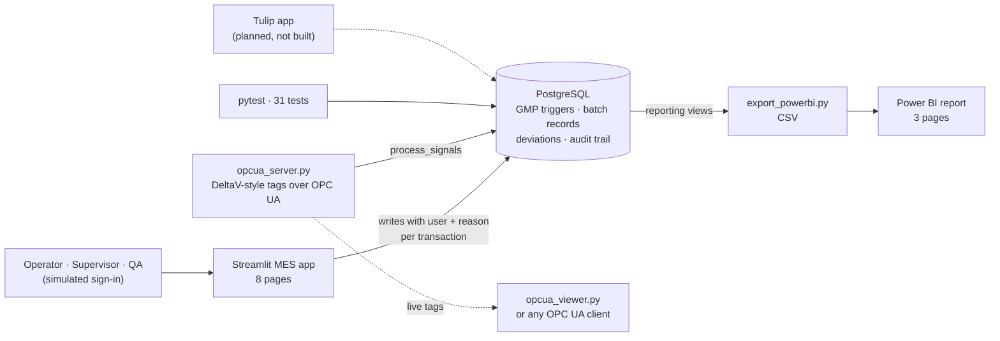

Batch lifecycle. Every status change is made by a database trigger, never by the app:

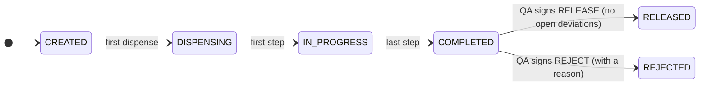

More detail: [docs/Architecture.md](docs/Architecture.md), with the rule map, session context and design decisions.

## The app (8 pages)

| Page | What it does |
|---|---|
| Batch Overview | Status, progress and open deviations for every batch |
| Create Batch | Pick an approved master recipe and see its BOM and steps |
| Dispensing | Weigh against target and tolerance, with first-expiry-first-out lot suggestion and second-person verification |
| Step Execution | Guided steps with limits, plus corrections that require a reason |
| Review by Exception | QA sees only deviations, changed records and alarms, then closes deviations and signs |
| Traceability | Forward and backward genealogy |
| Process Signals | DeltaV-style tag trends, with alarms marked |
| Audit Trail | Filterable, append-only log with old and new JSON |

The **"Signed in as"** picker simulates login so you can switch between operator, supervisor and QA. It is not real authentication.

### Screenshots

| | |
|---|---|
| **Batch Overview**<br/>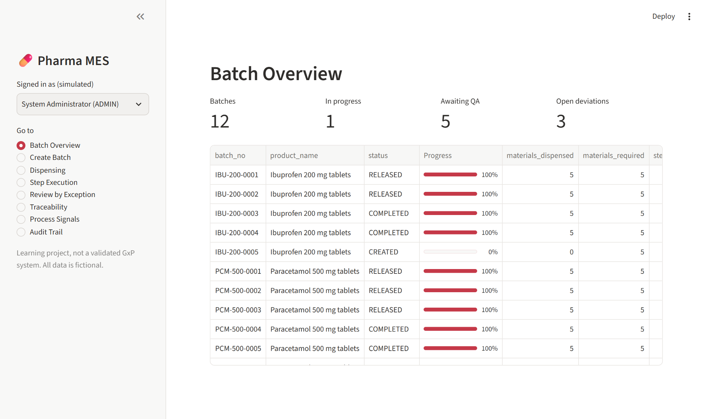 | **Create Batch**<br/>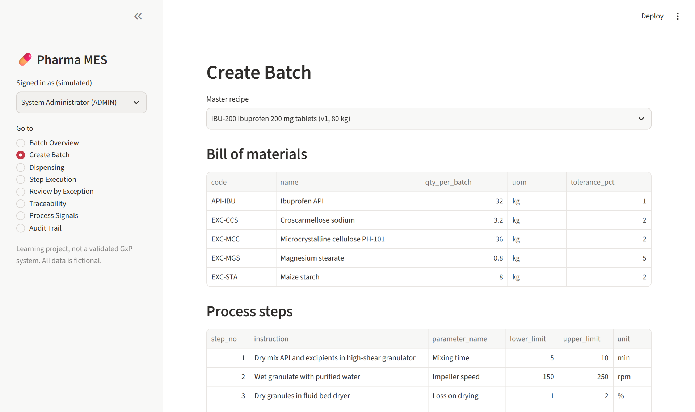 |
| **Dispensing**: target, tolerance, FEFO lot, second-person verifier<br/>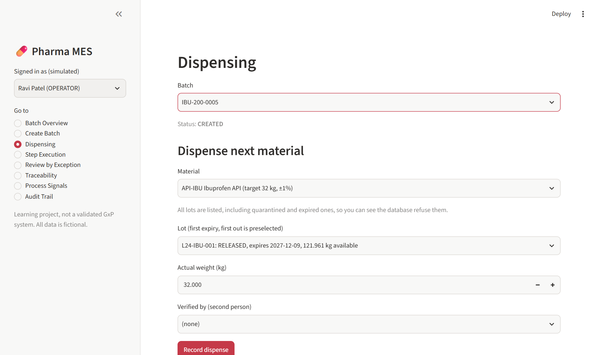 | **Step Execution**: limits shown, out-of-limit raises a deviation<br/>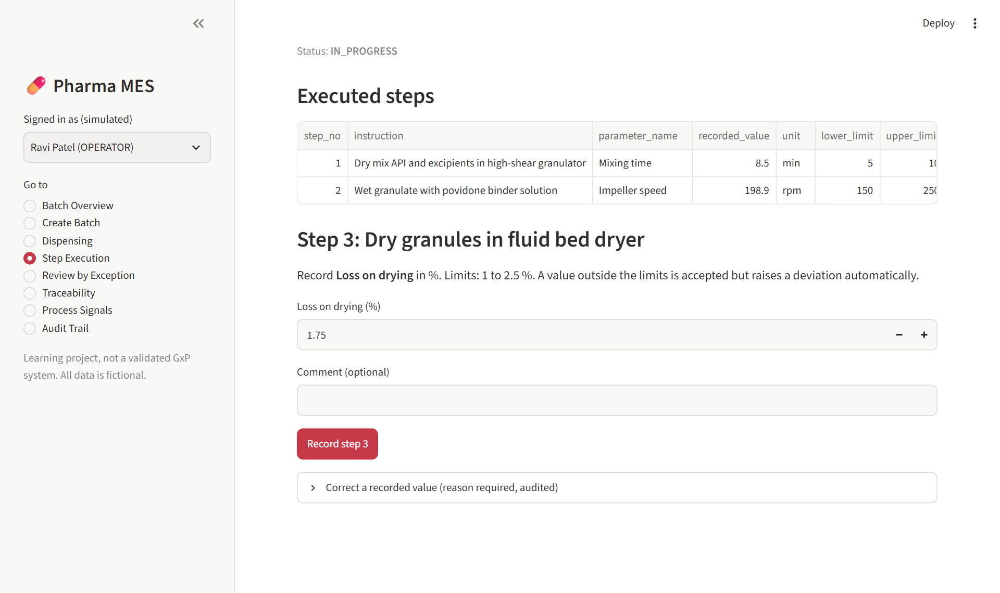 |
| **Review by Exception**: an open deviation and a corrected record<br/>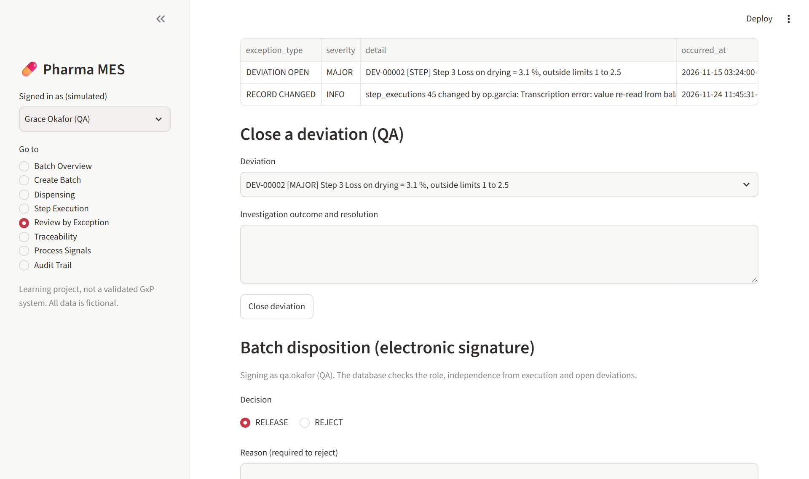 | **Release refused by the database**: open deviation<br/>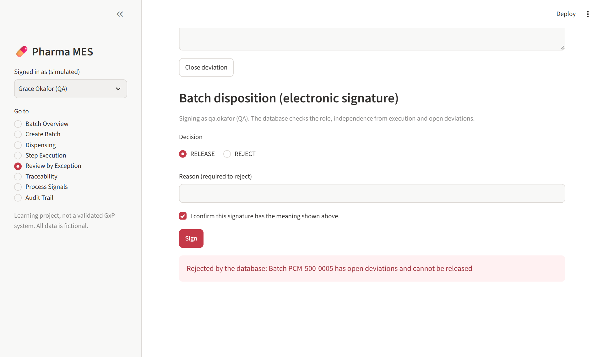 |
| **Process Signals**: dryer temperature excursion above 70 °C<br/>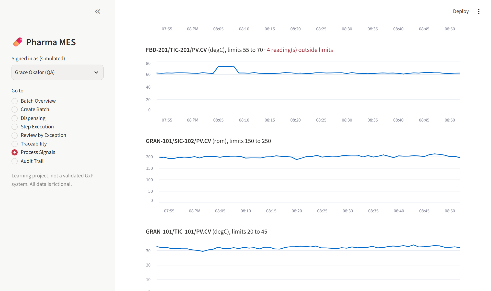 | **Traceability**: one lot traced to every batch<br/>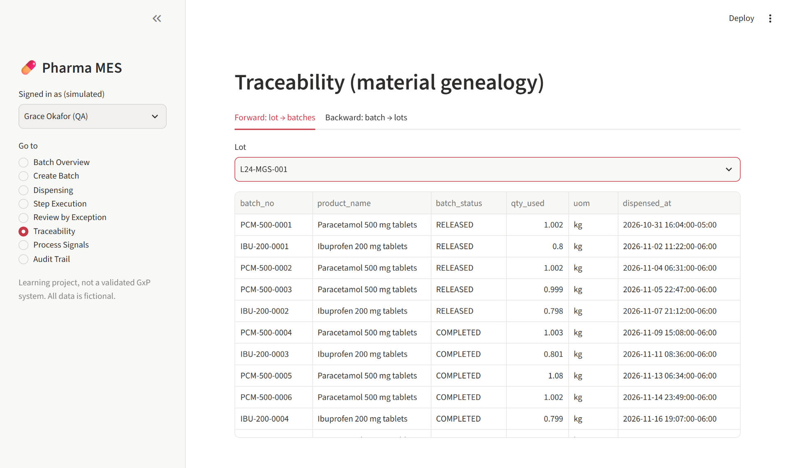 |
| **Audit Trail**: append-only, old and new values<br/>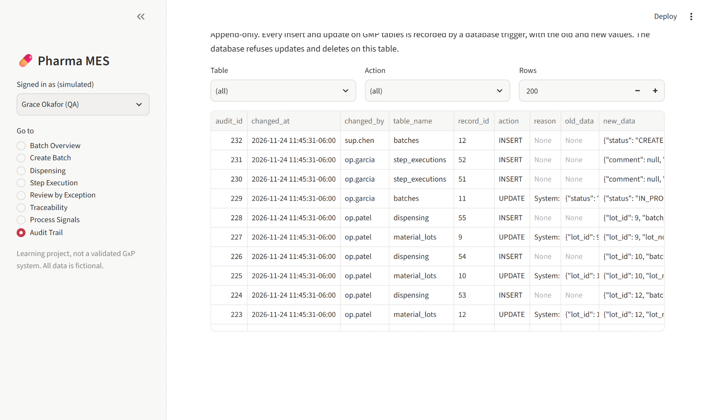 | |

## Sample data

`seed.py` loads 12 fictional batches of two products (paracetamol 500 mg and ibuprofen 200 mg tablets):

- 5 released by QA
- 2 complete and waiting for QA, with no exceptions
- **3 complete with a deliberate deviation for a reviewer to find:**
  - magnesium stearate dispensed 8 % over target (tolerance 5 %)
  - loss on drying 3.1 % against a limit of 2.5 %, plus a later corrected tablet-weight entry with its reason
  - dryer inlet air temperature excursion to about 73 °C (alarm limit 70 °C)
- 1 in progress, 1 just created

The lots include a quarantined, a rejected and an expired lot, so you can watch the database refuse them.

## Tests

**31 passing**, all run automatically on every push (GitHub Actions, PostgreSQL 17):
- 25 GMP rule tests that hit the database directly
- 2 OPC UA end-to-end tests
- 4 app tests that drive the Streamlit pages headlessly

```
pytest -v
...
Testing/test_gmp_rules.py::test_rule_violations_are_database_errors_not_app_checks PASSED
Testing/test_opcua_server.py::test_tags_are_published_and_excursion_breaches_limit PASSED
Testing/test_opcua_server.py::test_logged_excursion_raises_a_deviation_on_the_batch PASSED
============================= 31 passed in 15.31s =============================
```

- **[docs/Testing.md](docs/Testing.md):** the full list of tests, what each one proves, and a worked deviation example.
- **[docs/Validation.md](docs/Validation.md):** validation documents written the way a validation package would record them: 30 requirements with risk ratings, a traceability matrix to the tests, a 22-case protocol with results, a validation summary and a Part 11 / Annex 11 concept mapping. This is a portfolio demonstration, not a validated GxP system.

## Project structure

```
Pharmaceutical_MES/
  schema.sql         tables, GMP triggers, views
  app.py             Streamlit UI (8 pages)
  mes.py             thin write helpers shared by app, seed and tests
  seed.py            creates the database and loads the sample data
  simulator.py       DeltaV-style process signal simulator
  opcua_server.py    OPC UA server publishing the simulated tags
  opcua_viewer.py    OPC UA client printing live tag values
  export_powerbi.py  exports the reporting views to powerbi/data/*.csv
  db.py              connection settings (MES_DB_* variables)
Testing/
  test_gmp_rules.py     25 tests, one or more per GMP rule
  test_opcua_server.py  2 tests: reads the tags, triggers an excursion, logs it to a batch
  test_app_ui.py        4 tests: drives the Streamlit app headlessly (AppTest)
powerbi/             Power BI report (.pbix), Power BI Project (.pbip) and CSV data
docs/
  Architecture.md      rule map, batch lifecycle, design decisions
  Testing.md           what the tests prove, latest results
  Validation.md        requirements, traceability, test protocol, summary, Part 11 mapping
  Tulip_App_Design.md  design spec for a Tulip front end (planned)
  PowerBI_Guide.md     dashboard measures and layout
.github/workflows/tests.yml   runs the tests on every push
```

## Run it

Requires Python 3.10+ and PostgreSQL 14+.

```bash
python -m venv .venv
.venv\Scripts\activate             # Windows  (macOS/Linux: source .venv/bin/activate)
pip install -r requirements.txt
copy .env.example .env             # then set MES_DB_PASSWORD

python Pharmaceutical_MES/seed.py  # creates the mes_portfolio database if needed and loads sample data
pytest -v                          # uses a separate mes_portfolio_test database
streamlit run Pharmaceutical_MES/app.py
```

Generate more process data for a batch from the command line:

```bash
python Pharmaceutical_MES/simulator.py PCM-500-0007 --minutes 30 --excursion
```

### OPC UA server (simulated DeltaV tags)

`opcua_server.py` publishes the four simulated tags over **OPC UA** at `opc.tcp://localhost:4840/pharma-mes/`, updating every second. This is the role a DCS plays in a real plant, and any OPC UA client can browse and subscribe to the tags. A writable `SIM/Excursion` tag pushes the dryer inlet temperature above its 70 °C alarm limit.

Start the server in one window:
```bash
python Pharmaceutical_MES/opcua_server.py
```

Watch the live values from a second window:
```bash
python Pharmaceutical_MES/opcua_viewer.py
```

Switch the simulated excursion on and back off:
```bash
python Pharmaceutical_MES/opcua_viewer.py --excursion on
python Pharmaceutical_MES/opcua_viewer.py --excursion off
```

To also write the values into the batch record, start the server with `--log-batch PCM-500-0007` (every 60 s by default). An excursion then raises a deviation through the same database trigger as everything else.

```
time          GRAN-101/TIC-101/PV.CV    GRAN-101/SIC-102/PV.CV     FBD-201/TIC-201/PV.CV      FBD-201/MT-202/PV.CV
10:56:18           32.84 degC               198.78 rpm                 63.49 degC                22.65 %RH
10:56:19           32.68 degC               200.25 rpm                 74.77 degC  ALARM         23.01 %RH
```

The server uses no encryption or login and listens only on this computer.

**Windows: "running scripts is disabled"** when activating the virtual environment. Either run this once:
```powershell
Set-ExecutionPolicy -Scope CurrentUser RemoteSigned
```
or skip activation and call the environment's Python directly, for example `.\.venv\Scripts\python.exe Pharmaceutical_MES/opcua_server.py`. If you run plain `python` without activating, you'll get `No module named ...` errors.

**Windows note:** if the `psycopg-binary` DLL is blocked (for example by Smart App Control), set `PSYCOPG_IMPL=python` in `.env`. `db.py` then uses `libpq.dll` from the local PostgreSQL install.

## Power BI dashboard

`powerbi/Pharma_MES.pbix` is a three-page report on the three reporting views. The same report is also saved as a Power BI Project (`Pharma_MES.pbip`), whose files are readable in a git diff. It reads CSV exports of the views, so opening it needs no database password. To refresh the data, run:

```bash
python Pharmaceutical_MES/export_powerbi.py   # writes powerbi/data/*.csv
```

Then click **Refresh** in Power BI.

**Batch Status**: KPIs (released, awaiting QA, open deviations, right-first-time, average release time) and progress per batch


**Review by Exception**: exceptions per batch and their details
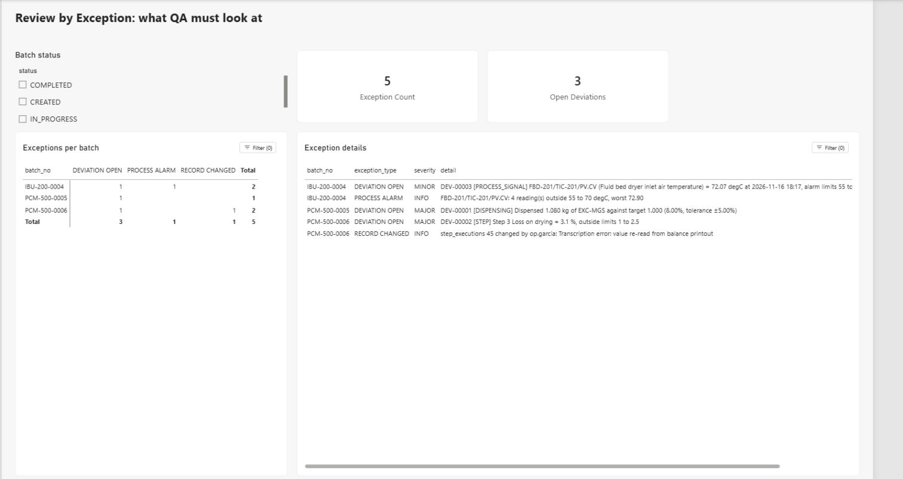

**Traceability**: lot-to-batch genealogy with lot and batch slicers
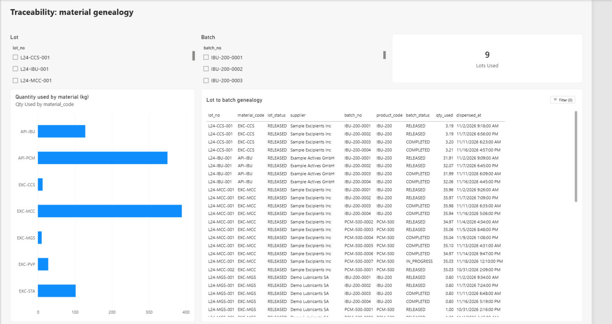

The data source paths point to `C:\GitHub\Pharmaceutical-MES-Portfolio\powerbi\data\`. If you clone the repository somewhere else, change them in **Transform data → Data source settings**.

## Simulation and limitations

| Built and working | Simulated | Planned, not built |
|---|---|---|
| Database rules, Streamlit app, OPC UA server and viewer, Power BI report, 31 automated tests | All data (products, lots, people); process signals (a Python simulator, not a real DeltaV DCS); sign-in (a user picker, not authentication) | Tulip front end ([design spec](docs/Tulip_App_Design.md)); a SCADA or MES client such as Ignition connected to the OPC UA server |

This is a demonstration application, not a validated GxP system. It shows 21 CFR Part 11-style data-integrity concepts; it is not a compliant system.

## What this project demonstrates

- **MES and ISA-88 batch concepts:** master recipe, dispensing against BOM tolerances, guided step execution, batch disposition.
- **GMP data integrity (ALCOA+):** attributable, append-only audit trail, reason for change, second-person verification, independent QA review.
- **Review by exception:** QA works from a list of deviations, changed records and alarms instead of reading every entry.
- **Traceability for recalls and investigations:** forward and backward genealogy.
- **Shop-floor connectivity:** process tags published over OPC UA, alarms turned into deviations.
- **Engineering practice:** rules enforced in PostgreSQL (PL/pgSQL triggers, constraints, JSONB audit, views), automated tests in CI, Power BI reporting.
